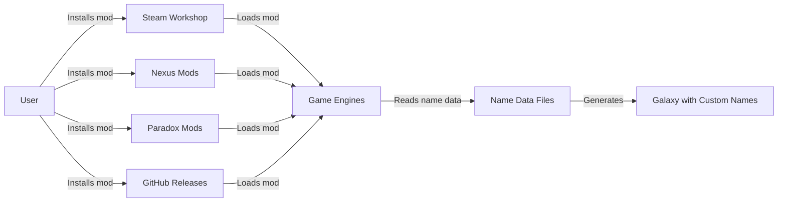
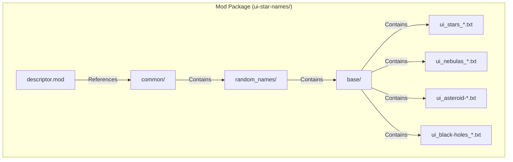
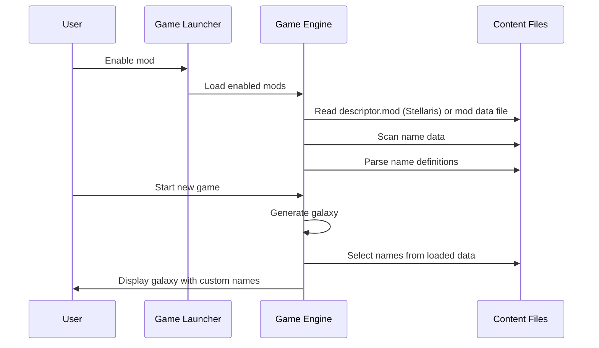
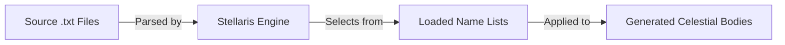
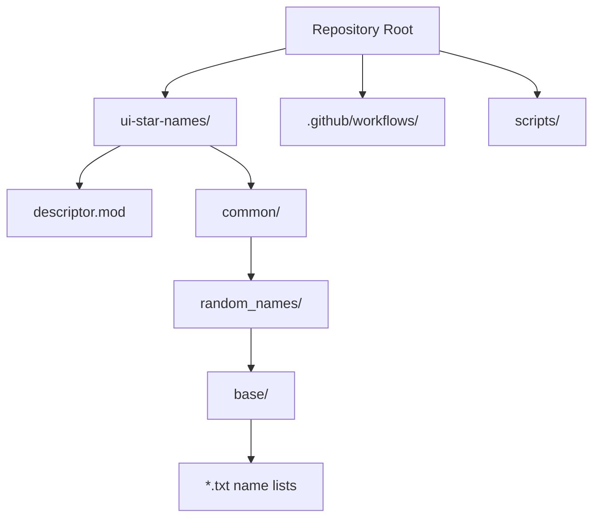

# Stellaris - Universum Infinitum - Star Names Architecture

This document describes the current architecture of the Universum Infinitum - Star Names project, a data-only set of modifications for the games Stellaris, Galactic Civilizations II, and Galactic Civilizations III that adds thousands of new star names, and for Stellaris additionally adds nebula, asteroid, and black hole names.

## 📑 Table of Contents

- [Purpose](#purpose)
- [System Context](#system-context)
- [Architectural Style](#architectural-style)
- [Runtime Flow](#runtime-flow)
- [Architectural Areas](#architectural-areas)
- [Data Architecture](#data-architecture)
- [Interfaces and Integrations](#interfaces-and-integrations)
- [Dependency Direction and Rules](#dependency-direction-and-rules)
- [External Dependencies](#external-dependencies)
- [Deployment and Operations](#deployment-and-operations)
- [Compatibility Contracts](#compatibility-contracts)
- [Testing and Verification](#testing-and-verification)
- [Design Constraints](#design-constraints)
- [Source Map](#source-map)
- [Related Documentation](#related-documentation)

## 🎯 Purpose

This project extends galaxy generation in Stellaris, Galactic Civilizations II, and Galactic Civilizations III by providing additional name data. The architecture is purely data-driven: it consists of static text and XML files that each game engine reads during galaxy generation. There is no executable code, runtime, or independent process. The document audience includes mod maintainers, contributors, and users who wish to understand the project structure and contribution workflow.

## 🌐 System Context

The project operates entirely within the mod loading and galaxy generation systems of Stellaris, Galactic Civilizations II, and Galactic Civilizations III.



The principal external boundaries are:
- **Game Engines (Stellaris, Galactic Civilizations II, Galactic Civilizations III):** Stellaris loads the mod descriptor and reads name list files during galaxy generation, applying names to generated celestial bodies; Galactic Civilizations II reads its own star name file before mods are loaded; Galactic Civilizations III reads a star name string table through a mod that replaces the vanilla file. The project has no control over when or how an engine uses the data.
- **Distribution Platforms (Steam Workshop, Nexus Mods, Paradox Mods, GitHub Releases):** Host and deliver the packaged content to users. The maintainers publish releases to these platforms via automated workflows.
- **GitHub Repository:** Source of truth for name sources, mod descriptors, and release automation. Contributors submit changes via pull requests.

## 🏗️ Architectural Style

**Data-only mod / Resource pack**

The repository implements a data-provider pattern. All functionality is declarative: text and XML files conforming to each game's expected format are placed in the expected directory structure, and each game engine provides all logic for parsing, selecting, and applying names. The repository additionally contains a generation script that aggregates the source name lists into the distributable content for each game, and release automation that publishes the generated output; the content itself has no runtime and no dependencies beyond the games.



The principal architecture boundaries are:
- **Stellaris Mod Root (`ui-star-names/`):** Top-level container recognised by the game launcher. Owns `descriptor.mod` and the `common/` directory.
- **Stellaris Name List Directory (`common/random_names/base/`):** Flat directory containing all name list files. Each file is independent and follows Stellaris' `name_list` format.
- **Stellaris Distribution Descriptors (`ui-star-names.mod`, `descriptor.mod`):** Metadata files consumed by distribution platforms and the game launcher.
- **Galactic Civilizations II Data File (`out/galciv2/Data/English/STARS.txt`):** Star name file that replaces the game's shipped file, since the game does not load star names from a mod.
- **Galactic Civilizations III Mod (`out/galciv3/ui-star-names/`):** Mod folder containing `Text/StarNamesText.xml` plus the mandatory `ParticleScriptDefs`, `Core`, and `Game` folders the game requires every mod to provide; the `Text/StarNamesText.xml` file replaces the game's shipped star name string table when the folder is placed in the game's `Mods` directory.

## 🔄 Runtime Flow

The content has no independent runtime. The execution flow is entirely within each game engine:



The principal runtime sequence is:
1. User enables the mod in the game launcher (Stellaris and Galactic Civilizations III) or replaces the shipped data file (Galactic Civilizations II)
2. For Stellaris and Galactic Civilizations III, the launcher or game registers the mod path
3. The game engine loads the mod or reads the data file on game start
4. The engine scans the name data: `common/random_names/base/` for Stellaris, `Text/StarNamesText.xml` for Galactic Civilizations III, or `Data/English/STARS.txt` for Galactic Civilizations II
5. The engine parses each file as name definitions
6. During galaxy generation, the engine randomly selects names from the loaded data
7. Generated celestial bodies receive names from the project's data

## 🗂️ Architectural Areas

### Galactic Civilizations Data

Paths:
- `out/galciv2/Data/English/STARS.txt`
- `out/galciv3/ui-star-names/Text/StarNamesText.xml`

Responsibilities:
- Provide the star name data file that replaces the Galactic Civilizations II shipped file
- Provide the star name string table that the Galactic Civilizations III mod replaces

Boundary rules:
- The Galactic Civilizations II file uses one star name per line, the Windows-1252 encoding, and CRLF line endings
- The Galactic Civilizations III file is a `StringTableList` conforming to `StringTable.xsd`, with contiguous `RANDOM_STAR_NAME_<index>` labels, the UTF-8 encoding, and CRLF line endings
- Both files are generated from the same source star names

### Name List Data

Paths:
- `ui-star-names/common/random_names/base/`

Responsibilities:
- Provide name lists for stars, nebulas, asteroids, and black holes
- Organise names by source universe (Star Wars, Star Trek, Dune, etc.) or category
- Conform to Stellaris `name_list` format: each file defines one or more `name_list` blocks with `prefix`, `suffix`, or `name` entries

Boundary rules:
- Files must use `.txt` extension
- Each file must contain valid Clausewitz script syntax for `name_list` definitions
- No subdirectories; all name list files reside directly in `base/`
- Naming convention: `ui_<category>_<source>.txt` (e.g., `ui_stars_star-wars.txt`)

### Mod Metadata

Paths:
- `ui-star-names.mod`
- `ui-star-names/descriptor.mod`

Responsibilities:
- Define mod identity, version compatibility, and tags for the game launcher
- `ui-star-names.mod`: Used by Steam Workshop upload workflow; references the mod directory
- `descriptor.mod`: Read by the game launcher; contains `name`, `path`, `tags`, `supported_version`

Boundary rules:
- Both files must have matching `name` and `path` values
- `supported_version` must match the target Stellaris version (currently `4.5.*`)
- `tags` must include `Galaxy Generation` for correct categorisation

### Release Automation

Paths:
- `.github/workflows/build.yml`
- `.github/workflows/steam-workshop-release.yml`
- `.github/workflows/nexus-mods-release.yml`
- `.github/workflows/github-release.yml`
- `scripts/count-additions.sh`
- `scripts/generate-mod.py`

Responsibilities:
- Build the Stellaris mod and the Galactic Civilizations II and III star name data from the source name lists on every push and pull request to `master`
- Automate packaging and publishing to Steam Workshop, Nexus Mods, and GitHub Releases on version tag push
- Generate the complete distributable mod under `out/stellaris/` from `src/names/`, or the Galactic Civilizations II star name data file under `out/galciv2/Data/English/STARS.txt`, or the Galactic Civilizations III star name data file under `out/galciv3/ui-star-names/Text/StarNamesText.xml`, from the star name lists, according to the `--game` argument
- `scripts/count-additions.sh`: Utility script to count unique names across all source list files for release notes

Boundary rules:
- The build workflow triggers on pushes and pull requests to `master` and runs one job per game; release workflows trigger on Git tags matching `v*.*.*`, while the GitHub Release workflow triggers on release publication or manual dispatch
- Each workflow generates the mod itself with `scripts/generate-mod.py` from the checked-out repository
- The build and GitHub Release workflows generate all three games, one job per game; the Steam Workshop workflow currently generates only the Stellaris mod with `--game stellaris`, while the Nexus Mods workflow generates all three games in its single `release` job
- Release content: the `ui-star-names/` directory and `ui-star-names.mod`
- Steam workflow uses `hmlendea/steam-workshop-update` action with stored credentials
- Nexus workflow uploads the archive via the Nexus Mods API
- GitHub Release workflow uploads `ui-star-names_<version>.zip`, `ui-star-names-galciv2_<version>.zip`, and `ui-star-names-galciv3_<version>.zip` with `softprops/action-gh-release`
- GitHub release asset naming convention: `ui-star-names_<version>.zip` for Stellaris, `ui-star-names-galciv2_<version>.zip` for Galactic Civilizations II, and `ui-star-names-galciv3_<version>.zip` for Galactic Civilizations III

## 💾 Data Architecture

The mod's data consists entirely of name list files in Clausewitz script format. Each file defines one or more `name_list` blocks.



| Data or Store | Owner | Representation and Storage | Lifecycle or Consistency |
|---------------|-------|----------------------------|--------------------------|
| `ui_stars_*.txt` | Mod maintainers | Plain text, Clausewitz `name_list` blocks with `name` entries | Static; updated via pull requests; loaded at game start |
| `ui_nebulas_*.txt` | Mod maintainers | Plain text, Clausewitz `name_list` blocks with `name` entries | Static; updated via pull requests; loaded at game start |
| `ui_asteroid-prefixes.txt` | Mod maintainers | Plain text, Clausewitz `name_list` blocks with `prefix` entries | Static; updated via pull requests; loaded at game start |
| `ui_asteroid-postfixes.txt` | Mod maintainers | Plain text, Clausewitz `name_list` blocks with `suffix` entries | Static; updated via pull requests; loaded at game start |
| `ui_black-holes_*.txt` | Mod maintainers | Plain text, Clausewitz `name_list` blocks with `name` entries | Static; updated via pull requests; loaded at game start |
| `Data/English/STARS.txt` | Mod maintainers | Plain text, one star name per line, Windows-1252 encoding, CRLF line endings | Static; updated via pull requests; replaces the game's shipped file |
| `Text/StarNamesText.xml` | Mod maintainers | XML `StringTableList` with `RANDOM_STAR_NAME_<index>` labels, UTF-8 encoding, CRLF line endings | Static; updated via pull requests; loaded through the mod at game start |

Each name list file follows this structure:
```
name_list = {
    category = "star"  # or nebula, asteroid, black_hole
    name = "Alpha Centauri"
    name = "Betelgeuse"
    # ... more names
}
```

Asteroid prefixes/suffixes use `prefix = "..."` and `suffix = "..."` instead of `name`.

## 🔌 Interfaces and Integrations

| Interface or Integration | Direction | Contract | Owner | Failure Semantics |
|--------------------------|-----------|----------|-------|-------------------|
| Stellaris Mod Descriptor | Outbound | `descriptor.mod` with `name`, `path`, `tags`, `supported_version` | Mod maintainers | Mod not listed in launcher if invalid |
| Stellaris Name List Format | Outbound | Clausewitz script `name_list` blocks with `category`, `name`/`prefix`/`suffix` | Mod maintainers | Names not used if syntax invalid |
| Galactic Civilizations II Star Name File | Outbound | Plain-text `STARS.txt`, one name per line, Windows-1252 encoding, CRLF line endings | Mod maintainers | Vanilla names used if the file is not replaced or does not parse |
| Galactic Civilizations III Star Name String Table | Outbound | XML `StringTableList` with `RANDOM_STAR_NAME_<index>` labels conforming to `StringTable.xsd`, UTF-8 encoding, CRLF line endings | Mod maintainers | Game crashes if the XML does not validate; vanilla names used if the mod is not enabled |
| Workflow release packaging | Internal | ZIP archives containing each game's content, built from the repository | GitHub Actions workflow | Release fails; manual upload required |
| Steam Workshop API | Outbound | ZIP archive with `ui-star-names/` and `ui-star-names.mod` | GitHub Actions workflow | Release fails; manual upload required |
| Nexus Mods API | Outbound | ZIP archive uploaded via API with version metadata | GitHub Actions workflow | Release fails; manual upload required |
| GitHub Releases | Outbound | `ui-star-names_<version>.zip`, `ui-star-names-galciv2_<version>.zip`, and `ui-star-names-galciv3_<version>.zip` archives attached to the published release | GitHub Actions workflow | Users cannot download from GitHub |

## 🧭 Dependency Direction and Rules

The content has no code dependencies. The only architectural rules concern file placement and format:

- **Permitted:** Name list files in `ui-star-names/common/random_names/base/` with `.txt` extension
- **Permitted:** Stellaris mod descriptor files at `ui-star-names.mod` and `ui-star-names/descriptor.mod`
- **Permitted:** Generated Galactic Civilizations II data files under `out/galciv2/` and Galactic Civilizations III mod files under `out/galciv3/`
- **Permitted:** GitHub Actions workflows in `.github/workflows/`
- **Prohibited:** Executable code, scripts that run at game time, DLLs, or any binary assets
- **Prohibited:** Subdirectories under `base/` (the game engine expects a flat list of files)
- **Prohibited:** Modifying game files directly in the repository (content must be self-contained and generated)



## 📦 External Dependencies

| Dependency | Responsibility | Integration Boundary | Architectural Consequence |
|------------|----------------|----------------------|---------------------------|
| Stellaris Game Engine (v4.5.*) | Parses name lists, generates galaxy, applies names | Mod descriptor and name list files | Content only works with a compatible game version; breaking changes in name list format would require content updates |
| Galactic Civilizations II Game Engine | Reads star names from its own `Data/English/STARS.txt` before mods are loaded, generates galaxy | Replaced star name file | Names only apply when the shipped file is replaced; the game does not load star names from a mod |
| Galactic Civilizations III Game Engine | Reads star names from `Text/StarNamesText.xml` through a mod, generates galaxy | Mod folder containing the replaced star name table | The XML must validate against `StringTable.xsd` or the game crashes; names only apply to newly generated galaxies |
| Steam Workshop | Distribution platform | GitHub Actions workflow + release ZIP | Requires Steam credentials in repository secrets; workflow must match Steam's upload API |
| Nexus Mods | Distribution platform | GitHub Actions workflow + release ZIP | Requires Nexus API key in repository secrets; workflow must match Nexus upload API |
| Paradox Mods | Distribution platform | Manual upload by maintainers | No automation; maintainers must manually publish each release |
| GitHub Actions | CI/CD runtime | Workflow YAML files | Workflows run on Ubuntu runners; depend on third-party actions (`hmlendea/steam-workshop-update`, `Nexus-Mods/upload-action`, `softprops/action-gh-release`) |

## 🚀 Deployment and Operations

| Concern | Current Design | Architectural Consequence |
|---------|----------------|---------------------------|
| Process topology | No processes; static files loaded by game engine | Zero operational overhead; no servers, daemons, or background tasks |
| Deployment unit | ZIP archives containing each game's content | One artefact per game deployed to its platforms; version tagged in Git; built by each workflow at release time |
| Persistent state | None | No migration, backup, or state management needed |
| Filesystem requirements | Stellaris mod directory placed in the game's `mod/` folder; Galactic Civilizations II files replace the game's shipped files; the Galactic Civilizations III mod folder is placed in the game's `Mods` directory | User or launcher handles placement; the content is self-contained |
| Scaling assumptions | N/A (single-user, client-side) | No scaling concerns |
| Startup/shutdown | Game engine loads on launch, unloads on exit | No content-specific startup or shutdown logic |
| Operator-visible outputs | Names appear in generated galaxy | No logs, metrics, or health endpoints |

Release process:
1. Maintainer creates and pushes a Git tag `vX.Y.Z`
2. Maintainer publishes a GitHub Release for the tag
3. GitHub Release workflow triggers, builds `ui-star-names_<version>.zip`, `ui-star-names-galciv2_<version>.zip`, and `ui-star-names-galciv3_<version>.zip`, and attaches them to the release
4. Steam Workshop workflow triggers, builds the Stellaris release archive from the repository, and uploads it to Steam
5. Nexus Mods workflow triggers, builds the Stellaris, Galactic Civilizations II, and Galactic Civilizations III archives from the repository, and uploads them to Nexus
6. Maintainer manually uploads the Stellaris archive to Paradox Mods

## 🛡️ Compatibility Contracts

| Contract | Owner | Invariant | Verification | Change Policy |
|----------|-------|-----------|--------------|---------------|
| Stellaris `supported_version` | Mod maintainers | `descriptor.mod` `supported_version` matches target game version | Manual verification on game update | Update on each major/minor Stellaris release |
| Stellaris name list format | Mod maintainers | All `.txt` files parse as valid Clausewitz `name_list` blocks | Game loads mod without errors | Preserve format; only add/remove name entries |
| Galactic Civilizations II star name file | Mod maintainers | `STARS.txt` uses one name per line, the Windows-1252 encoding, and CRLF line endings | Game reads the replaced file without issue | Preserve format; only add/remove name entries |
| Galactic Civilizations III star name string table | Mod maintainers | `StarNamesText.xml` validates against `StringTable.xsd` with contiguous `RANDOM_STAR_NAME_<index>` labels | Game loads the mod without crashing | Preserve format and label scheme; only add/remove name entries |
| Release archive structure | GitHub Actions | The Stellaris ZIP contains `ui-star-names/` (with `descriptor.mod` and `common/`) and `ui-star-names.mod`; the GalCiv2 ZIP contains `Data/` and `Twilight/`; the GalCiv3 ZIP contains `ui-star-names/` with `Text/StarNamesText.xml` and the mandatory `ParticleScriptDefs`, `Core`, and `Game` folders | Workflow validation; manual test install | Maintain directory structure; do not rename top-level folders or archive entries |
| Mod name and path | Mod maintainers | `ui-star-names.mod` and `descriptor.mod` have identical `name` and `path` | Manual review | Change only if mod identity changes |

## ✅ Testing and Verification

No automated test suite exists. Verification is manual:

1. **Installation test:** Install the Stellaris mod via Steam Workshop, Nexus Mods, or manual ZIP extraction and verify it appears in the Stellaris launcher; place the Galactic Civilizations III mod folder in the game's `Mods` directory; replace the Galactic Civilizations II data files
2. **Load test:** Enable the mod (or replace the files), start a new game; verify no launcher errors or game crashes
3. **Content test:** Observe the generated galaxy; verify the project's names appear for stars (and, for Stellaris, nebulas, asteroids, and black holes)
4. **Count verification:** Run `scripts/count-additions.sh` to confirm name counts match expectations

Execute the principal manual verification with:
```bash
# Count unique names in all list files
./scripts/count-additions.sh
```

Material coverage gaps:
- No syntax validation for the Clausewitz script format or the Galactic Civilizations III XML
- No automated check for duplicate names across files
- No verification that `supported_version` matches the current Stellaris version
- No integration test for the Steam and Nexus upload workflows (they require secrets)

## ⚠️ Design Constraints

- **Game version coupling:** The Stellaris `supported_version` (`4.5.*`) ties that content to a specific Stellaris version range. Major game updates may require content updates.
- **Format rigidity:** Name list files must conform exactly to Stellaris' expected Clausewitz script syntax, the Galactic Civilizations II file to its plain-text format, and the Galactic Civilizations III file to the `StringTable.xsd` schema. The project cannot extend or modify these formats.
- **Flat file structure:** The Stellaris engine expects all name list files directly in `common/random_names/base/` with no subdirectories. This limits organisational options.
- **Fixed star names:** In Galactic Civilizations III, the mod replaces only the random star names; fixed homeworld star systems keep their own names.
- **No runtime logic:** The project cannot implement conditional naming, weighted selection, or context-aware names. All names have equal probability.
- **Distribution platform dependencies:** Automated publishing requires maintaining GitHub Actions workflows and secrets for Steam and Nexus Mods. Paradox Mods requires manual upload.
- **No localisation support:** Names are provided in English only. The content does not use Stellaris' localisation system.

## 🗺️ Source Map

| Area | Path |
|------|------|
| Mod root | `ui-star-names/` |
| Mod descriptor (launcher) | `ui-star-names/descriptor.mod` |
| Mod descriptor (Steam) | `ui-star-names.mod` |
| Name list directory | `ui-star-names/common/random_names/base/` |
| Star name lists | `ui-star-names/common/random_names/base/ui_stars_*.txt` |
| Nebula name lists | `ui-star-names/common/random_names/base/ui_nebulas_*.txt` |
| Asteroid prefix lists | `ui-star-names/common/random_names/base/ui_asteroid-prefixes*.txt` |
| Asteroid postfix lists | `ui-star-names/common/random_names/base/ui_asteroid-postfixes*.txt` |
| Black hole name lists | `ui-star-names/common/random_names/base/ui_black-holes_*.txt` |
| Galactic Civilizations II star name file (generated) | `out/galciv2/Data/English/STARS.txt` |
| Galactic Civilizations III star name string table (generated) | `out/galciv3/ui-star-names/Text/StarNamesText.xml` |
| Build workflow | `.github/workflows/build.yml` |
| Steam Workshop workflow | `.github/workflows/steam-workshop-release.yml` |
| Nexus Mods workflow | `.github/workflows/nexus-mods-release.yml` |
| GitHub Release workflow | `.github/workflows/github-release.yml` |
| Name counting script | `scripts/count-additions.sh` |
| Mod generation script | `scripts/generate-mod.py` |
| Release archive (generated) | `ui-star-names_<version>.zip` |
| Galactic Civilizations II release archive (generated) | `ui-star-names-galciv2_<version>.zip` |
| Galactic Civilizations III release archive (generated) | `ui-star-names-galciv3_<version>.zip` |
| Workflow archive (generated) | `release.zip` |

## 📚 Related Documentation

- [README.md](./README.md) — Project overview, installation, usage, and contribution guidelines
- [CONTRIBUTING.md](./CONTRIBUTING.md) — Detailed contribution process, development setup, and pull request guidelines
- [SECURITY.md](./SECURITY.md) — Security policy, supported versions, vulnerability reporting, and disclosure process
- [PRIVACY.md](./PRIVACY.md) — Privacy and data handling statement (no personal data processed)
- [CODE_OF_CONDUCT.md](./CODE_OF_CONDUCT.md) — Community conduct standards and reporting process
- [LICENSE](./LICENSE) — GNU General Public License v3 terms