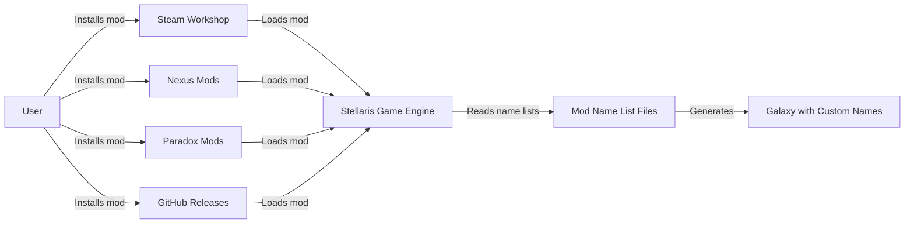
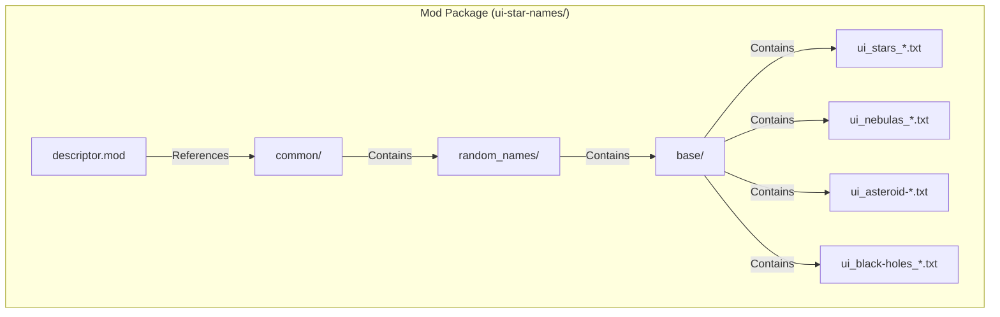
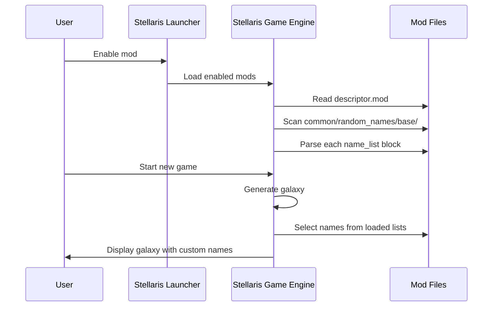
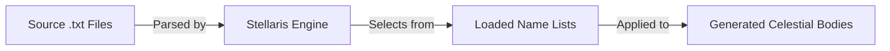
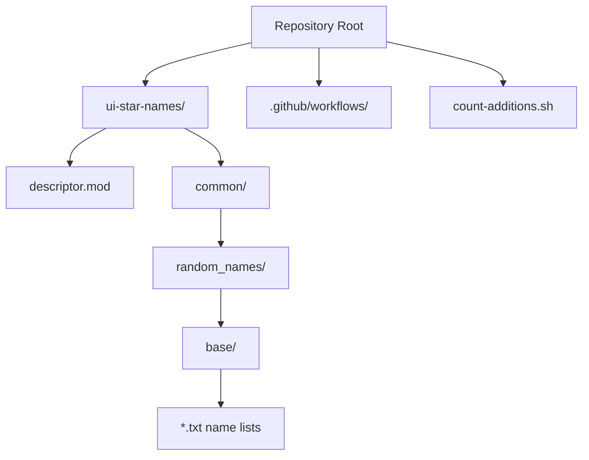

# Stellaris - Universum Infinitum - Star Names Architecture

This document describes the current architecture of the Stellaris - Universum Infinitum - Star Names mod, a data-only modification for the game Stellaris that adds thousands of new names for stars, nebulas, asteroids, and black holes.

## 📑 Table of Contents

- [Purpose](#purpose)
- [System Context](#system-context)
- [Architectural Style](#architectural-style)
- [Runtime Flow](#runtime-flow)
- [Architectural Areas](#architectural-areas)
- [Data Architecture](#data-architecture)
- [Interfaces and Integrations](#interfaces-and-integrations)
- [Dependency Direction and Rules](#dependency-direction-and-rules)
- [External Dependencies](#external-dependencies)
- [Deployment and Operations](#deployment-and-operations)
- [Compatibility Contracts](#compatibility-contracts)
- [Testing and Verification](#testing-and-verification)
- [Design Constraints](#design-constraints)
- [Source Map](#source-map)
- [Related Documentation](#related-documentation)

## 🎯 Purpose

This mod extends Stellaris galaxy generation by providing additional name lists for celestial bodies. The architecture is purely data-driven: the mod consists of static text files that the Stellaris game engine reads during galaxy generation. There is no executable code, runtime, or independent process. The document audience includes mod maintainers, contributors, and users who wish to understand the mod structure and contribution workflow.

## 🌐 System Context

The mod operates entirely within the Stellaris game engine's mod loading and galaxy generation systems.



The principal external boundaries are:
- **Stellaris Game Engine:** Loads the mod descriptor, reads name list files during galaxy generation, applies names to generated celestial bodies. The mod has no control over when or how the engine uses the data.
- **Distribution Platforms (Steam Workshop, Nexus Mods, Paradox Mods, GitHub Releases):** Host and deliver the packaged mod files to users. The mod maintainers publish releases to these platforms via automated workflows.
- **GitHub Repository:** Source of truth for name list files, mod descriptors, and release automation. Contributors submit changes via pull requests.

## 🏗️ Architectural Style

**Data-only mod / Resource pack**

The repository implements a pure data-provider pattern. All functionality is declarative: text files conforming to Stellaris' name list format are placed in the expected directory structure. The game engine provides all logic for parsing, selecting, and applying names. There are no scripts, no build step, no runtime, and no dependencies beyond the game itself.



The principal architecture boundaries are:
- **Mod Root (`ui-star-names/`):** Top-level container recognised by the game launcher. Owns `descriptor.mod` and `common/` directory.
- **Name List Directory (`common/random_names/base/`):** Flat directory containing all name list files. Each file is independent and follows Stellaris' `name_list` format.
- **Distribution Descriptors (`ui-star-names.mod`, `descriptor.mod`):** Metadata files consumed by distribution platforms and the game launcher.

## 🔄 Runtime Flow

The mod has no independent runtime. The execution flow is entirely within the Stellaris game engine:



The principal runtime sequence is:
1. User enables the mod in the Stellaris launcher
2. Launcher reads `descriptor.mod` and registers the mod path
3. Game engine loads the mod on game start
4. Engine scans `common/random_names/base/` for `.txt` files
5. Engine parses each file as a `name_list` definition
6. During galaxy generation, engine randomly selects names from loaded lists
7. Generated celestial bodies receive names from the mod's lists

## 🗂️ Architectural Areas

### Name List Data

Paths:
- `ui-star-names/common/random_names/base/`

Responsibilities:
- Provide name lists for stars, nebulas, asteroids, and black holes
- Organise names by source universe (Star Wars, Star Trek, Dune, etc.) or category
- Conform to Stellaris `name_list` format: each file defines one or more `name_list` blocks with `prefix`, `suffix`, or `name` entries

Boundary rules:
- Files must use `.txt` extension
- Each file must contain valid Clausewitz script syntax for `name_list` definitions
- No subdirectories; all name list files reside directly in `base/`
- Naming convention: `ui_<category>_<source>.txt` (e.g., `ui_stars_star-wars.txt`)

### Mod Metadata

Paths:
- `ui-star-names.mod`
- `ui-star-names/descriptor.mod`

Responsibilities:
- Define mod identity, version compatibility, and tags for the game launcher
- `ui-star-names.mod`: Used by Steam Workshop upload workflow; references the mod directory
- `descriptor.mod`: Read by the game launcher; contains `name`, `path`, `tags`, `supported_version`

Boundary rules:
- Both files must have matching `name` and `path` values
- `supported_version` must match the target Stellaris version (currently `4.5.*`)
- `tags` must include `Galaxy Generation` for correct categorisation

### Release Automation

Paths:
- `.github/workflows/steam-workshop.yml`
- `.github/workflows/nexus-mods.yml`
- `.github/workflows/github-release.yml`
- `count-additions.sh`

Responsibilities:
- Automate packaging and publishing to Steam Workshop, Nexus Mods, and GitHub Releases on version tag push
- `count-additions.sh`: Utility script to count unique names across all list files for release notes

Boundary rules:
- Workflows trigger on Git tags matching `v*.*.*`, while the GitHub Release workflow triggers on release publication
- Each workflow builds the release archive itself from the checked-out repository
- Release archive contents: the `ui-star-names/` directory and `ui-star-names.mod`
- Steam workflow uses `hmlendea/steam-workshop-update` action with stored credentials
- Nexus workflow uploads the archive via the Nexus Mods API
- GitHub Release workflow uploads `ui-star-names_<version>.zip` with `softprops/action-gh-release` and appends a SHA1 checksum to the release notes
- GitHub release asset naming convention: `ui-star-names_<version>.zip`

## 💾 Data Architecture

The mod's data consists entirely of name list files in Clausewitz script format. Each file defines one or more `name_list` blocks.



| Data or Store | Owner | Representation and Storage | Lifecycle or Consistency |
|---------------|-------|----------------------------|--------------------------|
| `ui_stars_*.txt` | Mod maintainers | Plain text, Clausewitz `name_list` blocks with `name` entries | Static; updated via pull requests; loaded at game start |
| `ui_nebulas_*.txt` | Mod maintainers | Plain text, Clausewitz `name_list` blocks with `name` entries | Static; updated via pull requests; loaded at game start |
| `ui_asteroid-prefixes.txt` | Mod maintainers | Plain text, Clausewitz `name_list` blocks with `prefix` entries | Static; updated via pull requests; loaded at game start |
| `ui_asteroid-postfixes.txt` | Mod maintainers | Plain text, Clausewitz `name_list` blocks with `suffix` entries | Static; updated via pull requests; loaded at game start |
| `ui_black-holes_*.txt` | Mod maintainers | Plain text, Clausewitz `name_list` blocks with `name` entries | Static; updated via pull requests; loaded at game start |

Each name list file follows this structure:
```
name_list = {
    category = "star"  # or nebula, asteroid, black_hole
    name = "Alpha Centauri"
    name = "Betelgeuse"
    # ... more names
}
```

Asteroid prefixes/suffixes use `prefix = "..."` and `suffix = "..."` instead of `name`.

## 🔌 Interfaces and Integrations

| Interface or Integration | Direction | Contract | Owner | Failure Semantics |
|--------------------------|-----------|----------|-------|-------------------|
| Stellaris Mod Descriptor | Outbound | `descriptor.mod` with `name`, `path`, `tags`, `supported_version` | Mod maintainers | Mod not listed in launcher if invalid |
| Stellaris Name List Format | Outbound | Clausewitz script `name_list` blocks with `category`, `name`/`prefix`/`suffix` | Mod maintainers | Names not used if syntax invalid |
| Workflow release packaging | Internal | ZIP archive containing `ui-star-names/` and `ui-star-names.mod`, built from the repository | GitHub Actions workflow | Release fails; manual upload required |
| Steam Workshop API | Outbound | ZIP archive with `ui-star-names/` and `ui-star-names.mod` | GitHub Actions workflow | Release fails; manual upload required |
| Nexus Mods API | Outbound | ZIP archive uploaded via API with version metadata | GitHub Actions workflow | Release fails; manual upload required |
| GitHub Releases | Outbound | `ui-star-names_<version>.zip` archive attached to the published release, with a SHA1 checksum in the release notes | GitHub Actions workflow | Users cannot download from GitHub |

## 🧭 Dependency Direction and Rules

The mod has no code dependencies. The only architectural rules concern file placement and format:

- **Permitted:** Name list files in `ui-star-names/common/random_names/base/` with `.txt` extension
- **Permitted:** Mod descriptor files at `ui-star-names.mod` and `ui-star-names/descriptor.mod`
- **Permitted:** GitHub Actions workflows in `.github/workflows/`
- **Prohibited:** Executable code, scripts that run at game time, DLLs, or any binary assets
- **Prohibited:** Subdirectories under `base/` (the game engine expects a flat list of files)
- **Prohibited:** Modifying Stellaris game files directly (mod must be self-contained)



## 📦 External Dependencies

| Dependency | Responsibility | Integration Boundary | Architectural Consequence |
|------------|----------------|----------------------|---------------------------|
| Stellaris Game Engine (v4.5.*) | Parses name lists, generates galaxy, applies names | Mod descriptor and name list files | Mod only works with compatible game version; breaking changes in name list format would require mod updates |
| Steam Workshop | Distribution platform | GitHub Actions workflow + release ZIP | Requires Steam credentials in repository secrets; workflow must match Steam's upload API |
| Nexus Mods | Distribution platform | GitHub Actions workflow + release ZIP | Requires Nexus API key in repository secrets; workflow must match Nexus upload API |
| Paradox Mods | Distribution platform | Manual upload by maintainers | No automation; maintainers must manually publish each release |
| GitHub Actions | CI/CD runtime | Workflow YAML files | Workflows run on Ubuntu runners; depend on third-party actions (`hmlendea/steam-workshop-update`, `Nexus-Mods/upload-action`, `softprops/action-gh-release`) |

## 🚀 Deployment and Operations

| Concern | Current Design | Architectural Consequence |
|---------|----------------|---------------------------|
| Process topology | No processes; static files loaded by game engine | Zero operational overhead; no servers, daemons, or background tasks |
| Deployment unit | ZIP archive containing `ui-star-names/` and `ui-star-names.mod` | Single artefact deployed to all platforms; version tagged in Git; built by each workflow at release time |
| Persistent state | None | No migration, backup, or state management needed |
| Filesystem requirements | Mod directory placed in Stellaris `mod/` folder | User or launcher handles placement; mod is self-contained |
| Scaling assumptions | N/A (single-user, client-side) | No scaling concerns |
| Startup/shutdown | Game engine loads on launch, unloads on exit | No mod-specific startup or shutdown logic |
| Operator-visible outputs | Names appear in generated galaxy | No logs, metrics, or health endpoints |

Release process:
1. Maintainer creates and pushes a Git tag `vX.Y.Z`
2. Maintainer publishes a GitHub Release for the tag
3. GitHub Release workflow triggers, builds `ui-star-names_<version>.zip`, attaches it to the release, and appends its SHA1 checksum to the release notes
4. Steam Workshop workflow triggers, builds the release archive from the repository, and uploads to Steam
5. Nexus Mods workflow triggers, builds the release archive from the repository, and uploads to Nexus
6. Maintainer manually uploads the archive to Paradox Mods

## 🛡️ Compatibility Contracts

| Contract | Owner | Invariant | Verification | Change Policy |
|----------|-------|-----------|--------------|---------------|
| Stellaris `supported_version` | Mod maintainers | `descriptor.mod` `supported_version` matches target game version | Manual verification on game update | Update on each major/minor Stellaris release |
| Name list format | Mod maintainers | All `.txt` files parse as valid Clausewitz `name_list` blocks | Game loads mod without errors | Preserve format; only add/remove name entries |
| Release archive structure | GitHub Actions | ZIP contains `ui-star-names/` (with `descriptor.mod` and `common/`) and `ui-star-names.mod` | Workflow validation; manual test install | Maintain directory structure; do not rename top-level folder or archive entries |
| Mod name and path | Mod maintainers | `ui-star-names.mod` and `descriptor.mod` have identical `name` and `path` | Manual review | Change only if mod identity changes |

## ✅ Testing and Verification

No automated test suite exists. Verification is manual:

1. **Installation test:** Install mod via Steam Workshop, Nexus Mods, or manual ZIP extraction; verify it appears in Stellaris launcher
2. **Load test:** Enable mod, start new game; verify no launcher errors or game crashes
3. **Content test:** Observe generated galaxy; verify custom names appear for stars, nebulas, asteroids, black holes
4. **Count verification:** Run `count-additions.sh` to confirm name counts match expectations

Execute the principal manual verification with:
```bash
# Count unique names in all list files
./count-additions.sh
```

Material coverage gaps:
- No syntax validation for Clausewitz script format
- No automated check for duplicate names across files
- No verification that `supported_version` matches current Stellaris version
- No integration test for Steam/Nexus upload workflows (require secrets)

## ⚠️ Design Constraints

- **Game version coupling:** The mod's `supported_version` (`4.5.*`) ties it to a specific Stellaris version range. Major game updates may require mod updates.
- **Format rigidity:** Name list files must conform exactly to Stellaris' expected Clausewitz script syntax. The mod cannot extend or modify the format.
- **Flat file structure:** The game engine expects all name list files directly in `common/random_names/base/` with no subdirectories. This limits organisational options.
- **No runtime logic:** The mod cannot implement conditional naming, weighted selection, or context-aware names. All names have equal probability.
- **Distribution platform dependencies:** Automated publishing requires maintaining GitHub Actions workflows and secrets for Steam and Nexus Mods. Paradox Mods requires manual upload.
- **No localisation support:** Names are provided in English only. The mod does not use Stellaris' localisation system.

## 🗺️ Source Map

| Area | Path |
|------|------|
| Mod root | `ui-star-names/` |
| Mod descriptor (launcher) | `ui-star-names/descriptor.mod` |
| Mod descriptor (Steam) | `ui-star-names.mod` |
| Name list directory | `ui-star-names/common/random_names/base/` |
| Star name lists | `ui-star-names/common/random_names/base/ui_stars_*.txt` |
| Nebula name lists | `ui-star-names/common/random_names/base/ui_nebulas_*.txt` |
| Asteroid prefix lists | `ui-star-names/common/random_names/base/ui_asteroid-prefixes*.txt` |
| Asteroid postfix lists | `ui-star-names/common/random_names/base/ui_asteroid-postfixes*.txt` |
| Black hole name lists | `ui-star-names/common/random_names/base/ui_black-holes_*.txt` |
| Steam Workshop workflow | `.github/workflows/steam-workshop.yml` |
| Nexus Mods workflow | `.github/workflows/nexus-mods.yml` |
| GitHub Release workflow | `.github/workflows/github-release.yml` |
| Name counting script | `count-additions.sh` |
| Release archive (generated) | `ui-star-names_<version>.zip` |
| Workflow archive (generated) | `release.zip` |

## 📚 Related Documentation

- [README.md](./README.md) — Project overview, installation, usage, and contribution guidelines
- [CONTRIBUTING.md](./CONTRIBUTING.md) — Detailed contribution process, development setup, and pull request guidelines
- [SECURITY.md](./SECURITY.md) — Security policy, supported versions, vulnerability reporting, and disclosure process
- [PRIVACY.md](./PRIVACY.md) — Privacy and data handling statement (no personal data processed)
- [CODE_OF_CONDUCT.md](./CODE_OF_CONDUCT.md) — Community conduct standards and reporting process
- [LICENSE](./LICENSE) — GNU General Public License v3 terms