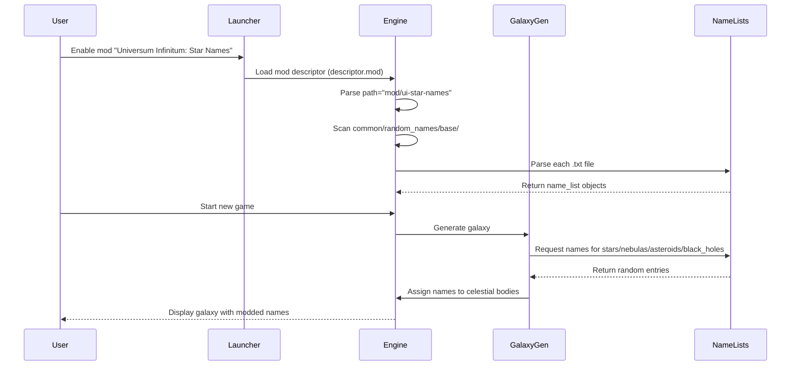

# Flow: Mod Loading and Galaxy Generation

## Overview

This flow describes how the Stellaris game engine discovers, loads, and applies the mod's name lists during galaxy generation.

## Sequence Diagram



## Detailed Steps

### 1. Mod Discovery (Launcher)

1. User subscribes to mod on Steam Workshop / downloads from Nexus / installs manually
2. Mod files placed in Stellaris mod directory:
   - `mod/ui-star-names/descriptor.mod`
   - `mod/ui-star-names/common/random_names/base/*.txt`
3. User opens Stellaris launcher
4. Launcher scans mod directory for `descriptor.mod` files
5. Launcher reads `descriptor.mod`:
   - `name="Universum Infinitum: Star Names"`
   - `path="mod/ui-star-names"`
   - `supported_version="4.5.*"`
   - `tags={ "Galaxy Generation" }`
6. Launcher displays mod in list with version compatibility status
7. User enables mod checkbox
8. Launcher writes enabled mod list to `dlc_load.json`

### 2. Mod Loading (Engine Startup)

1. User clicks "Play"
2. Engine reads `dlc_load.json` for enabled mods
3. For each enabled mod:
   - Resolves `path` relative to mod directory
   - Validates directory exists
   - Registers mod as data source
4. Engine builds virtual filesystem merging vanilla + mod data
5. Mod load order: Core → DLC → Mods (alphabetical within tier)

### 3. Name List Registration

1. Engine scans `common/random_names/base/` in virtual filesystem
2. For each `.txt` file:
   - Parses Clausewitz script
   - Validates `category` field matches filename convention
   - Registers `name_list` object in global registry
3. Registry keyed by category: `star`, `nebula`, `black_hole`, `asteroid_prefix`, `asteroid_suffix`
4. Each category contains array of name entries from all matching files

### 4. Galaxy Generation

1. User configures new game (galaxy size, shape, etc.)
2. Engine initialises `GalaxyGenerator`
3. For each star system to generate:
   - Selects star type (class, size)
   - Calls `NameList.GetRandom("star")` → returns random star name
   - Assigns to `StarSystem.name`
4. For each nebula to generate:
   - Calls `NameList.GetRandom("nebula")` → returns random nebula name
   - Assigns to `Nebula.name`
5. For each black hole to generate:
   - Calls `NameList.GetRandom("black_hole")` → returns random black hole name
   - Assigns to `BlackHole.name`
6. For each asteroid to generate:
   - Calls `NameList.GetRandom("asteroid_prefix")` + `NameList.GetRandom("asteroid_suffix")`
   - Concatenates: `prefix + suffix` (e.g., "Astra-" + "-Prime" = "Astra-Prime")
   - Assigns to `Asteroid.name`

### 5. Name Selection Algorithm

The engine uses weighted random selection:

```
For category C with entries E[1..n]:
  weight = 1.0 for each entry (uniform distribution)
  selected = E[random(1, n)]
```

No weights, priorities, or conditional logic in name lists — all entries equally likely.

### 6. Persistence

1. Generated galaxy saved to save file
2. Names stored as strings in save game
3. Mod not required to load save (names are baked in)
4. If mod disabled, new games use vanilla names; existing saves unchanged

## Data Flow

```
descriptor.mod (identity)
       ↓
common/random_names/base/*.txt (source data)
       ↓
Engine parser (Clausewitz → internal objects)
       ↓
Global Name Registry (category → [entries])
       ↓
GalaxyGenerator.GetRandom(category) → string
       ↓
CelestialBody.name = string
       ↓
Save game (baked names)
```

## Error Handling

| Failure Point | Behaviour |
|---------------|-----------|
| `descriptor.mod` missing | Mod not shown in launcher |
| `supported_version` mismatch | Mod shown as incompatible; can still enable |
| `.txt` parse error | File skipped; error logged to `error.log` |
| `category` missing/invalid | File skipped; error logged |
| No entries for category | Falls back to vanilla name list |
| Duplicate names across files | All kept; increases selection probability |

## Invariants

1. Mod must be enabled before galaxy generation
2. Name lists loaded once at engine startup
3. Galaxy generation is deterministic given same seed + mod state
4. Names baked into save — mod not needed to continue save
5. Asteroid names always prefix+suffix concatenation

## Extension Points

- Add new `.txt` files to `base/` → automatically discovered
- New categories not supported (hardcoded in engine)
- Localisation not supported for name lists