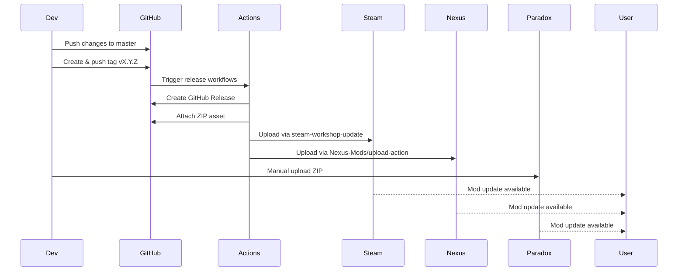

# Flow: Release and Distribution

## Overview

This flow describes the end-to-end process from code change to published mod on all three distribution platforms.

## Sequence Diagram



## Detailed Steps

### 1. Development Phase

1. Developer makes changes to name list files
2. Runs `./count-additions.sh` to verify entry counts
3. Tests locally by installing mod and starting new game
4. Commits changes to feature branch
5. Opens Pull Request
6. CI passes (no automated tests, but workflow syntax validated)
7. PR reviewed and merged to `master`

### 2. Release Preparation

1. Update `supported_version` in both descriptor files if Stellaris version changed
2. Update `CHANGELOG.md` (if exists) or prepare release notes
3. Ensure `master` branch is clean and up to date

### 3. Tag and Release Creation

```bash
# Create annotated tag
git tag -a vX.Y.Z -m "Release vX.Y.Z - <summary>"

# Push tag (triggers everything)
git push origin vX.Y.Z
```

### 4. GitHub Actions: Release Creation

1. Tag push triggers GitHub Release creation (automatic)
2. GitHub creates release at `https://github.com/hmlendea/stellaris-ui-star-names/releases/tag/vX.Y.Z`
3. Release asset must be attached — currently manual or via separate workflow
4. Expected asset name: `ui-star-names_<version>.zip` (e.g., `ui-star-names_1.2.3.zip`)

**Asset Structure**:
```
ui-star-names_1.2.3.zip
└── ui-star-names/
    ├── descriptor.mod
    └── common/
        └── random_names/
            └── base/
                └── *.txt
```

### 5. Steam Workshop Workflow (`.github/workflows/steam-workshop.yml`)

**Trigger**: Tag push `v*.*.*`

**Execution**:
1. Checkout repository
2. Download release asset:
   ```bash
   wget "https://github.com/hmlendea/stellaris-ui-star-names/releases/download/${{github.ref_name}}/ui-star-names_${GITHUB_REF:11}.zip" -O "release.zip"
   ```
3. Unzip to `release/`
4. Upload using `hmlendea/steam-workshop-update@v1.0.0`:
   - `appid`: 281990
   - `itemid`: 2040215185
   - `path`: `release/ui-star-names/`
   - `changenote`: BBCode link to GitHub release
5. Steam Workshop page updated

**Secrets Required**:
- `STEAM_USERNAME`
- `STEAM_PASSWORD`
- `STEAM_2FA_SEED`

### 6. Nexus Mods Workflow (`.github/workflows/nexus-mods.yml`)

**Trigger**: Tag push `v*.*.*` OR manual dispatch with tag input

**Execution**:
1. Checkout repository
2. Determine version: `${{ inputs.tag || github.ref_name }}`
3. Download release asset:
   ```bash
   RELEASE_ASSET_NAME="ui-star-names_${VERSION#v}.zip"
   wget "https://github.com/hmlendea/stellaris-ui-star-names/releases/download/${VERSION}/${RELEASE_ASSET_NAME}" -O "release.zip"
   ```
4. Upload using `Nexus-Mods/upload-action@v1.0.0-beta.10`:
   - `file_id`: 920143
   - `version`: Tag without `v` prefix
   - `description`: Link to GitHub release
   - `archive_existing_version`: true
   - `update_mod_version`: true
5. Nexus Mods page updated

**Secrets Required**:
- `NEXUSMODS_API_KEY`

### 7. Paradox Mods (Manual)

1. Go to `https://mods.paradoxplaza.com/mods/`
2. Log in with Paradox account
3. Find "Universum Infinitum: Star Names"
4. Click "Update" or "New Version"
5. Upload `ui-star-names_<version>.zip`
6. Fill changelog
7. Submit for review (if required)
8. Publish

### 8. Post-Release Verification

| Platform | Check |
|----------|-------|
| GitHub | Release exists with ZIP asset |
| Steam Workshop | Version updated, changenote visible |
| Nexus Mods | Version updated, file downloadable |
| Paradox Mods | Version updated, approved |

### 9. User Update Flow

1. User launches Stellaris
2. Launcher checks for mod updates
3. Steam: Auto-updates subscribed mods
4. Nexus: User downloads manually or uses Vortex/MO2
5. Paradox: Launcher shows update
6. User enables updated mod
7. New games use new names

## Data Flow

```
Git tag push
       ↓
GitHub Release + ZIP asset
       ↓
┌─────────────────────────────────────┐
│         Parallel Uploads            │
├──────────────────┬──────────────────┤
│ Steam Workshop   │ Nexus Mods       │
│ (auto)           │ (auto)           │
└────────┬─────────┴────────┬─────────┘
         │                 │
         ↓                 ↓
    Steam users      Nexus users
         │                 │
         └────────┬────────┘
                  ↓
           Paradox Mods (manual)
                  ↓
           All platforms current
```

## Timing

| Step | Duration |
|------|----------|
| Tag push → GitHub Release | ~30 seconds |
| GitHub Release → Steam upload | ~2-5 minutes |
| GitHub Release → Nexus upload | ~1-3 minutes |
| Manual Paradox upload | ~5-10 minutes |
| **Total automated** | **~3-8 minutes** |
| **Total with manual** | **~10-20 minutes** |

## Failure Recovery

### Steam Upload Fails

1. Check workflow logs for error
2. Common causes:
   - Invalid/expired credentials
   - Steam rate limiting
   - Workshop item ID changed
3. Recovery:
   - Fix secrets in GitHub repository settings
   - Re-run workflow manually (Actions tab → Run workflow)
   - Or upload manually via Steam Workshop website

### Nexus Upload Fails

1. Check workflow logs
2. Common causes:
   - Invalid API key
   - File ID mismatch
   - Rate limiting
3. Recovery:
   - Update `NEXUSMODS_API_KEY` secret
   - Re-run workflow manually
   - Or upload manually via Nexus Mods website

### Release Asset Missing

1. Check GitHub Release page
2. If no asset attached:
   - Create ZIP locally: `zip -r ui-star-names_<version>.zip ui-star-names/`
   - Attach to release via GitHub UI
   - Re-run both workflows

### Paradox Mods Rejection

1. Check rejection reason
2. Common: missing metadata, invalid ZIP structure
3. Fix and re-upload

## Invariants

1. Tag format must be `vX.Y.Z` (semantic versioning)
2. Release asset name must match `ui-star-names_<version>.zip`
3. Both descriptor files must have identical `name` and `path`
4. `supported_version` must match target Stellaris version
5. All three platforms should receive same version simultaneously

## Known Issues

- No automated release asset creation (relies on manual or separate process)
- Paradox Mods has no API — always manual
- Steam 2FA seed expires periodically
- Nexus Mods action is beta (`v1.0.0-beta.10`)
- No automated verification of uploaded content
- No rollback — must push new tag to fix